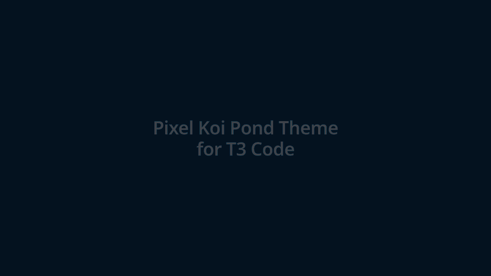
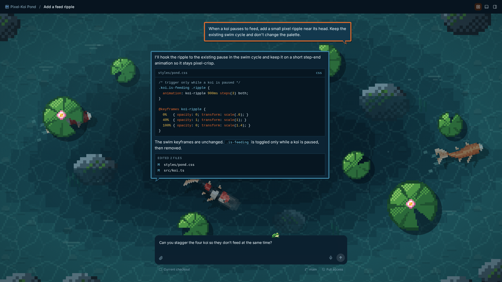

<div align="center">

  

# Pixel-Koi Pond

**An animated pixel-art koi pond theme for [T3 Code](https://t3.codes)**

Two variants, one lake: moody midnight water or bright jade shallows.




</div>

---

## ✨ Features

- 🐟 **Animated pixel koi** that swim around your workspace
- 🪨 **Pixel-art rocks and ripples** for a calm, cozy pond vibe
- 🌙 **Dark variant** with deep midnight water
- ☀️ **Light variant** with brighter jade shallows and light interface surfaces
- 💬 Designed to look great in the **chat area**, code blocks, and composer

## 🖼️ Screenshots

<table>
  <tr>
    <th>🌙 Dark — <code>pixelkoi</code></th>
    <th>☀️ Light — <code>pixelkoi-light</code></th>
  </tr>
  <tr>
    <td></td>
    <td></td>
  </tr>
</table>

## 🎨 Variants

| Variant | Theme ID | File |
| --- | --- | --- |
| 🌙 Dark | `pixelkoi` | [`pixel-koi-pond.json`](pixel-koi-pond.json) |
| ☀️ Light | `pixelkoi-light` | [`pixel-koi-pond-light.json`](pixel-koi-pond-light.json) |

## 📦 Install

### Option 1: Import in the app

1. Open T3 Code.
2. Go to **Settings → Appearance → Import**.
3. Select `pixel-koi-pond.json` or `pixel-koi-pond-light.json`.

### Option 2: Manual

Copy a JSON file into `~/.t3/userdata/themes/`, then select its ID:

```sh
t3 theme set pixelkoi
t3 theme set pixelkoi-light
```

---

<div align="center">

Made with 🎏 by [@kanigaraa](https://github.com/kanigaraa)

</div>
