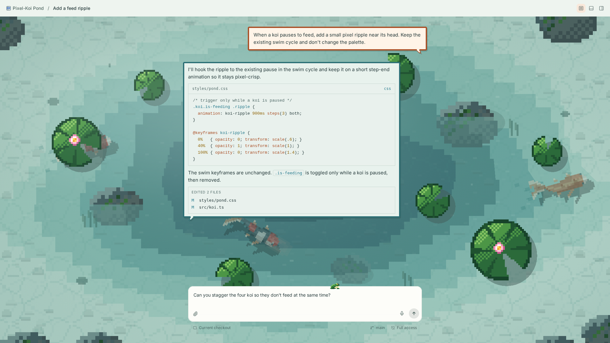

<div align="center">

  

# Pixel Koi Pond

</div>

A pixel-art theme for [T3 Code](https://t3.codes). Koi swim behind the chat, and a small frog follows your cursor while you type.

[](assets/demo.mp4)

It comes in two versions: a dark one with night water and a light one with shallow green water.

| Dark (`pixelkoi`) | Light (`pixelkoi-light`) |
| --- | --- |
|  |  |

## Files

- [`pixel-koi-pond.json`](themes/pixel-koi-pond.json) is the dark theme, id `pixelkoi`.
- [`pixel-koi-pond-light.json`](themes/pixel-koi-pond-light.json) is the light theme, id `pixelkoi-light`.

## Install

In T3 Code, open **Settings → Appearance → Import** and pick one of the JSON files.

You can also copy the file into `~/.t3/userdata/themes/` and switch to it from the terminal:

```sh
t3 theme set pixelkoi        # dark
t3 theme set pixelkoi-light  # light
```

---

Made by [@kanigaraa](https://github.com/kanigaraa).
